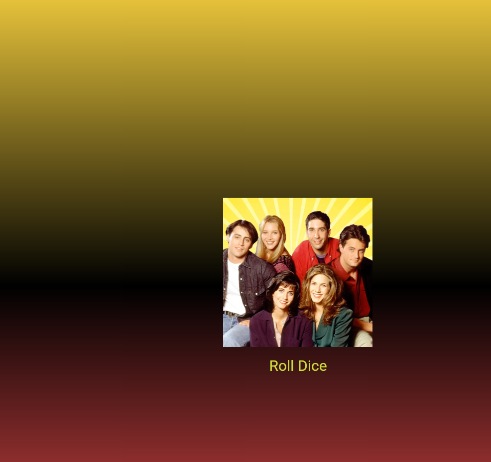

# Лабораторная работа №4-5. Flutter: структура UI и компонентный подход

* **Выполнил:** Шкурский Максим
* **Группа:** ИСП-242
* **Дата сдачи:** 13.11.2026

## Что сделал в этой работе:
1. Разобрался, как пилить свои виджеты и раскладывать их по отдельным файлам, чтобы код в `main.dart` не превращался в кашу.
2. Понял разницу между статичными виджетами (`Stateless`) и теми, которые могут меняться на экране (`Stateful`).
3. Научился прокидывать данные и цвета через параметры, чтобы один и тот же контейнер можно было использовать повторно.
4. Подключил внешние картинки через `pubspec.yaml` и настроил отступы, чтобы всё не ломалось.
5. Написал логику рандома для кубика: теперь при нажатии на кнопку приложение само подставляет нужную картинку и обновляет экран через `setState`.

## Как это выглядит в итоге

## Как запустить проект у себя:
1. `flutter pub get` подтянуть все зависимости и картинки.
2. `flutter run -d chrome` запустить проект в браузере.

## Ответы на вопросы к защите:

1. **Зачем выносить виджеты в отдельные файлы? Что изменится, если держать всё в main.dart?**
Если кидать всё в один файл, он быстро разрастется до тысячи строк. В таком коде потом сам черт ногу сломит, когда надо будет что-то исправить. А когда каждый виджет в своем файле — всё аккуратно, понятно, и этот код можно легко переиспользовать в других местах приложения.

2. **Что такое BuildContext? Почему метод build() принимает его как параметр?**
Это штука, которая показывает фреймворку, где конкретно этот виджет сидит в общем дереве приложения. `build()` принимает его, чтобы виджет мог понимать свое окружение — например, брать настройки темы, узнавать размеры экрана или связываться с другими виджетами повыше.

3. **Чем StatelessWidget отличается от StatefulWidget? Приведите пример, когда нужен каждый из них.**
`Stateless` это жестко заданный, статичный интерфейс. Он отрисовался один раз и сам по себе не меняется (например, обычный текст, иконка или фон). 
`Stateful` умеет обновлять экран прямо во время работы приложения, когда пользователь что-то нажимает. Он нужен там, где есть динамика — как наш кубик, который меняет грани, или какие-нибудь счетчики и поля ввода.

4. **Почему Random() создаётся на уровне файла, а не внутри rollDice()?**
Чтобы не плодить сущности в памяти устройства. Если засунуть `Random()` внутрь функции, то при каждом клике на кнопку будет создаваться новый генератор случай чисел, тратя ресурсы. А так мы создали один глобальный объект на весь файл и гоняем его по кругу — это намного быстрее и экономичнее.
